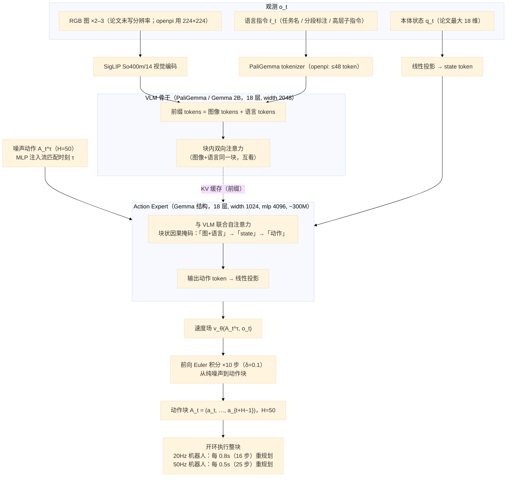
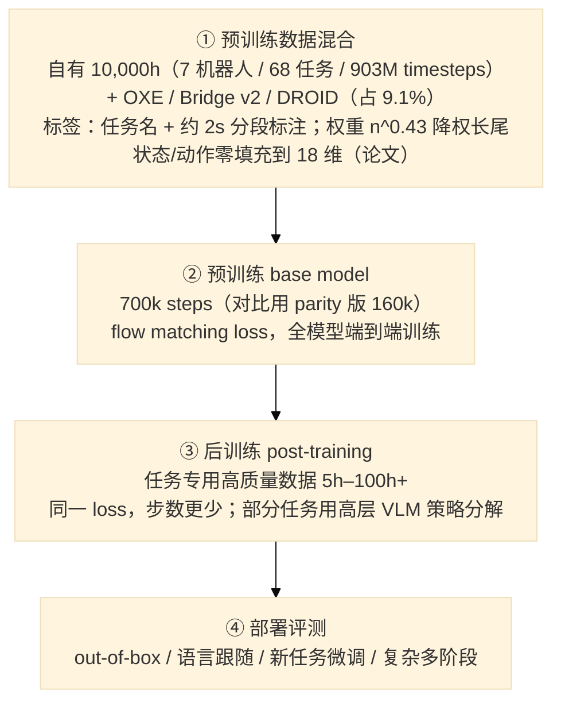
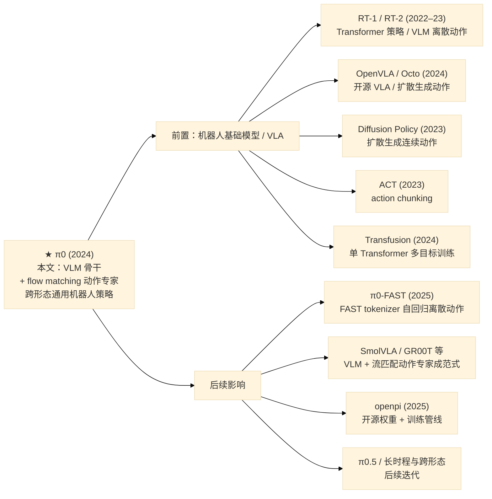

# π0: A Vision-Language-Action Flow Model for General Robot Control

> **一句话总结：** 这篇论文提出 **π0**——一个把**预训练 VLM 骨干（PaliGemma 3B）**与**流匹配（flow matching）动作专家（300M）**组合成的通用机器人策略（robot foundation model，3.3B 参数）：用**约 10,000 小时、7 种机器人构型、68 个任务**的跨形态数据（外加 OXE/Bridge/DROID）做预训练，再用高质量任务数据做后训练，首次在**真实机器人**上端到端学会折衣服、清理餐桌、组装纸箱、装鸡蛋等需要数十个行为组合的**长时程灵巧任务**（部分任务长达 5–20 分钟），并在 out-of-box 提示、语言跟随、新任务微调、复杂多阶段四类评测中全面超越 OpenVLA（7B）、Octo、ACT、Diffusion Policy。它也是"**VLM + 流匹配动作专家**"这一 VLA 架构范式的奠基之作。

> **⚙️ 配套复现：** 本工程**尚无 π0 复现**（π0 权重与训练需大规模算力/私有数据，暂不具备复现条件）；π0 在本工程中的角色是 SmolVLA 笔记的**对照基线**（见 [papers/02-smolvla/](../02-smolvla/) 与 [code/reproduction_smolvla.md](../../code/reproduction_smolvla.md)）。本笔记中凡涉及 π0 数字，均标注"论文说法"，未做独立复现。

## 1. Paper Information

- **标题**: π0: A Vision-Language-Action Flow Model for General Robot Control
- **作者**: Physical Intelligence 全体作者（按原文顺序）：Kevin Black, Noah Brown, Danny Driess, Adnan Esmail, Michael Equi, Chelsea Finn, Niccolo Fusai, Lachy Groom, Karol Hausman, Brian Ichter, Szymon Jakubczak, Tim Jones, Liyiming Ke, Sergey Levine, Adrian Li-Bell, Mohith Mothukuri, Suraj Nair, Karl Pertsch, Lucy Xiaoyang Shi, James Tanner, Quan Vuong, Anna Walling, Haohuan Wang, Ury Zhilinsky（均为 Physical Intelligence, San Francisco）
- **发表**: arXiv preprint (cs.LG) 2024-10-31（arXiv:2410.24164；当前 v4 修订于 2026-01-08。技术报告，未投正式会议）
- **链接**: [arXiv](https://arxiv.org/abs/2410.24164) | [Code（openpi）](https://github.com/Physical-Intelligence/openpi) | [Blog / Project Page](https://physicalintelligence.company/blog/pi0)

---

## 2. Motivation

### 2.1 Background

- **机器人学习要"通用"面临三大障碍**：数据、泛化、鲁棒性。NLP/CV 的经验是"先在大规模多样数据上预训练、再对齐/微调"的通用模型往往胜过专用模型；机器人领域有理由复制这条路。
- **现有 VLA 用"离散 token + 自回归"表示动作**（RT-2、OpenVLA）：把动作分箱成 token 后逐 token 预测，**不支持 action chunk，也难做高频控制**——而灵巧任务恰恰需要高频、连续、多模态的动作输出。
- **扩散/流匹配生成连续动作已有先例**（Diffusion Policy 等），但**没有用预训练 VLM 骨干**，因此缺乏互联网规模的语义常识与语言理解。
- **大规模机器人数据极度稀缺且形态各异**：不同机器人配置空间/动作表示不同（单臂、双臂、移动平台），需要 cross-embodiment 训练才能把数据合并利用；此前最大规模也只到"数十小时/任务"量级。

### 2.2 Goal

> **如何设计一个通用机器人策略（robot foundation model），使其既能继承互联网规模的视觉-语言语义知识，又能利用大规模、多形态的机器人数据，完成高灵巧、长时程、多阶段的真实世界操作任务？**

### 2.3 核心洞察

- **"VLM 骨干 + 流匹配动作专家"分工**：让预训练 VLM 负责语义感知与语言理解，让一个独立小专家负责连续动作生成——把"改大模型"变成"给 VLM 加一个流匹配头"，同时保留 VLM 的 Internet 常识。
- **动作是连续的、多模态的，必须用生成模型**：单一 L1/MSE 回归会把不同示范轨迹"平均"成不可执行的中间动作；流匹配能保留多模态分布，并支持一次性生成 **H=50** 的动作块（最高 50Hz 灵巧控制）。
- **预训练 / 后训练两阶段（模仿 LLM recipe）**：多样但较低质的预训练数据教会模型"出错后如何恢复"，高质量后训练数据教会模型"流畅高效地完成任务"；只学高质量数据会脆弱、只在预训练上零样本又不够精熟。

---

## 3. Core Ideas

### ① 流匹配 VLA 架构：VLM 骨干 + 独立 action expert（MoE 式双权重）

在 PaliGemma（SigLIP 视觉编码 + Gemma 2B 语言模型）之上，新增一组**独立的、从零初始化的动作专家权重（~300M）**，把机器人本体状态 $q_t$ 与**带噪动作块** $A_t^\tau$（H=50）路由给动作专家；图像与语言路由给 VLM 骨干。两套权重只在**联合自注意力层**交互，等价于一个"两个专家"的 mixture-of-experts。动作专家用**条件流匹配**生成连续动作分布，推理时 10 步 Euler 积分出整块动作。为什么重要：**这是全文最核心的架构贡献**——首次把 flow matching 动作头接到预训练 VLM 上，兼顾语义泛化与高频灵巧。

### ② 跨形态大规模预训练：10,000 小时 / 7 机器人 / 68 任务 + OXE

预训练混合数据由**自有 903M timesteps**（106M 单臂 + 797M 双臂，7 种构型、68 个任务）与 **9.1% 开源数据**（OXE / Bridge v2 / DROID）构成，共约 **10,000 小时**。不同机器人的状态/动作被**零填充到统一维度**（论文为 18 维），缺失相机槽位被 mask；任务-机器人组合按 $n^{0.43}$ 降权以平衡长尾。为什么重要：**证明单一跨形态模型可以同时控制单臂/双臂/移动平台**，并成为各下游任务的统一初始化。

### ③ 预训练 / 后训练两阶段 recipe

预训练（base model，700k steps）用**任务名 + 约 2 秒分段标注**的多样数据，目标是广泛能力与恢复行为；后训练用**任务专用的高质量数据（5 小时到 100+ 小时不等）**微调，目标是精熟与流畅。为什么重要：**这是把"通用基础模型"落到"具体灵巧任务"的关键方法论**——论文的复杂任务（折衣服、组装纸箱）几乎都靠后训练才达到可用水平。

### ④ 语言指令 + 高层 VLM 策略，支撑长时程任务

π0 原生接收语言输入；对需要语义推理的长时程任务（如"清理餐桌"），用一个**高层 VLM 策略**把"bus the table"分解成"pick up the napkin""throw the napkin into the trash"等中间子指令（类比 SayCan）。为什么重要：**把单策略的动作生成能力扩展到时序上数十步、语义上需要规划的任务**，是 π0 能完成 5–20 分钟任务的系统级关键。

---

## 4. Overall Framework

### 数据流（Inference Path）



> 关键设计：**两套权重（VLM 骨干 + action expert）共用一个自注意力计算**，token 按来源路由到对应专家；注意力掩码分 3 块 `[图+语言]`、`[state]`、`[动作]`，块内双向、块间只能"向后看"（见 §5.3）。训练/推理时**动作专家被前向 10 次**（流匹配积分），VLM 前缀的 KV 可缓存复用。

### 训练与数据组织（预训练 → 后训练两阶段，无在线交替）



---

## 5. Key Modules

### 5.1 VLM 骨干（PaliGemma：SigLIP + Gemma 2B）

#### Motivation

通用机器人策略需要互联网规模的**语义常识与语言理解**（"什么是餐巾""把盘子放进箱子"），这些知识从零训练无法获得；而一个开源的、足够小以便实时控制的 VLM 是"免费的世界知识来源"。

#### 核心思想

- 选择 **PaliGemma**（Gemma 2B 语言模型 + SigLIP So400m/14 视觉编码器），约 3B 参数；论文明确"用 PaliGemma 只是因为方便且相对小，框架兼容任何预训练 VLM"。
- **late fusion**：图像经视觉编码器嵌入到与语言 token 相同的嵌入空间；本体状态 $q_t$ 经线性投影加入；最终动作块经线性投影输出。
- Gemma 2B 结构（论文 Appendix B）：`{width=2048, depth=18, mlp dim=16384, num heads=18, num kv heads=1, head dim=256}`——注意 **"num heads=18" 是论文笔误**（18×256≠2048），openpi 实际用 **8 头**（见 §7 核对表 #2）。
- 骨干**初始化自 PaliGemma 但并非冻结**，随整个模型一起训练（论文说"further train"，openpi 默认也不冻结，仅提供可选 LoRA 变体）。

> **一句话总结：** 用一个预训练 VLM 承载"看懂场景 + 听懂语言"的全部语义能力，让动作专家只需学习"在给定语义条件下如何动"——这是 π0 泛化能力的来源。

### 5.2 Action Expert（流匹配动作专家）

#### Motivation

机器人动作是**连续、高维、多模态**的（同一观测下不同示范轨迹不同），离散化 + 自回归会损失精度且无法做 action chunk；而直接在 3B VLM 上做流匹配代价过高。需要一个"小、快、可多次前向"的连续动作生成器。

#### 核心思想

- **独立权重**：新增一组从零初始化的动作专家权重（**~300M**：`width=1024, depth=18, mlp dim=4096`），与 VLM 骨干构成"双专家"结构，只在自注意力层交互。
- **输入**：本体状态 $q_t$（线性投影为 state token）+ 带噪动作块 $A_t^\tau$（H=50 个 action token）。
- **流匹配目标**：训练 $v_\theta(A_t^\tau, o_t)$ 回归从噪声到数据的线性插值路径的速度场（见 §6），推理 10 步 Euler 积分。
- **时间步注入**：每个 action token 的嵌入为 $W_3\cdot\mathrm{swish}(W_2\cdot\mathrm{concat}(W_1 a_t^\tau,\ \phi(\tau)))$，其中 $\phi$ 是 $\tau$ 的正弦位置编码——比 AdaRMS 更轻量（openpi 的 π0 走这条路径，AdaRMS 是 π0.5 才启用）。
- 动作专家总参 ~300M，使"一次观测 + 10 次专家前向"能在消费级 GPU（RTX 4090）上达到实时（见 §8）。

> **一句话总结：** 一个轻量、可多次前向的流匹配 Transformer，专门把"语义条件 + 本体状态 + 噪声"积分成 H=50 的连续动作块——π0 高精度与高频灵巧的执行端。

### 5.3 块状因果注意力掩码（Blockwise Causal Attention）

#### Motivation

VLM 预训练时从未见过 state 与 action token，若让图像/语言 token 反过来关注这些新 token，会造成分布漂移；同时 state 在 10 步积分中不变、动作 token 需要互相看——需要一种既能复用预训练分布、又能缓存 KV、还允许块内双向的掩码。

#### 核心思想

- 序列分成 **3 个块**：`[I_1..I_n, ℓ_t]`（图像+语言）、`[q_t]`（状态）、`[a_t^\tau..a_{t+H-1}^\tau]`（带噪动作）。
- **块内全双向**（同块 token 互看）；**块间只能向后看**（不能 attend 未来块）。于是：图像/语言不能看到 state 与动作（最小化与 VLM 预训练的分布漂移）；state 能看图像/语言但看不到动作；动作能看全部。
- state 独占一块且不随积分步变化 → 其 KV 可缓存；动作块全双向 → 满足"所有动作 token 互相 attend"。

> **一句话总结：** 用"3 块 + 块内双向 + 块间因果"同时实现三件事：保护 VLM 预训练分布、允许动作块内部协调、支持推理时的 KV 缓存。

> **⚠️ 与官方实现的一个细微差异**：论文 Appendix D 称"$o_t$（含 state）的 keys/values 都被缓存"，但 openpi 实际**只缓存图像+语言前缀的 KV，state 每一步都重新投影**（见 §7 核对表 #7）。

### 5.4 数据混合与高层语言策略

#### Motivation

跨形态、跨任务的机器人数据规模大但极不均衡（难任务如折衣服被过度代表），且长时程任务需要语义规划，单一策略难以直接完成。

#### 核心思想

- **数据混合**：自有 7 机器人/68 任务 + OXE/Bridge/DROID；每个"任务-机器人"组合按样本数 $n^{0.43}$ 加权，压制过采样；状态/动作零填充到统一维度（论文 18 维），缺相机槽 mask。
- **语言标签**：同时使用**任务名**与**分段标注**（sub-trajectory 的细粒度标签，约 2 秒/段），使模型既能按整体任务、也能按中间子指令行动。
- **高层 VLM 策略**：对复杂任务（餐桌清理、折衣服），用高层 VLM 输出中间语言子指令（如"pick up the napkin"），π0 作为低层策略执行——把长时程任务分解为可执行的短片段。

> **一句话总结：** 用"重加权混合 + 任务名/分段双标签 + 高层语言分解"把海量异构机器人数据组织成可训练、可规划的预训练语料。

---

## 6. Mathematical Formulation

### 符号说明

| 符号 | 含义 | 维度 |
|------|------|------|
| $o_t=[I^1_t,\ldots,I^n_t,\ell_t,q_t]$ | t 时刻观测（多张 RGB + 语言 token + 本体状态） | 图像 + 语言序列 + 状态 |
| $I^i_t$ | 第 i 张相机图像（每机器人 2–3 张） | — |
| $q_t$ | 本体状态（关节角等） | 论文 ≤18；openpi 32 |
| $A_t=[a_t,\ldots,a_{t+H-1}]$ | 动作块（action chunk） | H×dim(a)，H=50 |
| $a_{t'}$ | 动作块中单个动作 | dim(a)（论文 ≤18；openpi 32） |
| $\epsilon$ | 标准高斯噪声 | 同 $A_t$ |
| $\tau\in[0,1]$ | 流匹配时间（论文约定：0=噪声，1=干净动作） | 标量 |
| $A_t^\tau$ | 噪声与动作的线性插值（带噪动作） | H×dim(a) |
| $v_\theta(A_t^\tau,o_t)$ | 网络预测的速度场（动作专家） | H×dim(a) |
| $u(A_t^\tau\mid A_t)$ | 目标速度场（回归目标） | H×dim(a) |
| $H$ | 动作块长度（horizon） | 50（基础模型） |
| $s$ | 时间采样截断阈值 | 0.999 |
| $w$ / $d$ | 动作专家嵌入宽度 / 动作维度 | $w$=1024 / $d$=dim(a) |
| $W_1,W_2,W_3$ | 时间步嵌入 MLP 的三层权重 | $w\times d,\ w\times 2w,\ w\times w$ |

### 条件流匹配目标（核心公式）

π0 把"从噪声生成动作块"建模为概率路径上的向量场回归。训练目标是让 $v_\theta$ 拟合**线性高斯（最优传输）路径**的速度场：

$$\mathcal{L}^{\tau}(\theta)\;=\;\mathbb{E}_{\,p(A_t\mid o_t),\;q(A_t^{\tau}\mid A_t)}\Big[\big\|\,v_\theta(A_t^{\tau},\,o_t)\;-\;u(A_t^{\tau}\mid A_t)\,\big\|^{2}\Big]$$

其中带噪动作与目标速度场（论文约定）为：

$$q(A_t^{\tau}\mid A_t)=\mathcal{N}\big(\tau A_t,\,(1-\tau)I\big),\qquad A_t^{\tau}=\tau A_t+(1-\tau)\,\epsilon,\qquad u(A_t^{\tau}\mid A_t)=A_t-\epsilon$$

- **直观理解**：$\tau=0$ 时 $A_t^0=\epsilon$（纯噪声），$\tau=1$ 时 $A_t^1=A_t$（干净动作）。$v_\theta$ 学会在每个中间点给出"指向干净动作"的方向 $A_t-\epsilon$；推理时从 $\tau=0$ 的噪声出发，沿学到的场积分到 $\tau=1$。
- **为什么用流匹配**：单一动作块的目标分布是多模态的（同指令不同轨迹），L1/MSE 回归会抹平模式；流匹配保留分布，且比自回归离散化更适合高频连续控制。

### 时间步采样分布

流匹配原论文从均匀分布采样 $\tau$；π0 认为**动作预测与图像生成不同**——观测 $o_t$ 对动作分布的约束远强于文本对图像的约束，因此"预测条件均值"本身已很难，应当**强调低 $\tau$（高噪声）**的难样本，并且**不采样高于阈值 $s$ 的 $\tau$**（只要积分步长 $\delta>1-s$ 就用不到）：

$$p(\tau)=\mathrm{Beta}\!\left(\frac{s-\tau}{s};\,1.5,\,1\right),\qquad s=0.999$$

- 该分布在 $\tau$ 接近 0 处权重更高；$s=0.999$ 允许最多 $\delta=1/1000$ 的积分步（即最多 1000 步）。
- **论文约定 vs 官方实现**：openpi 采用扩散文献更常见的**相反约定**（$t=1$ 噪声、$t=0$ 干净），代码注释直言 "this is the opposite of the pi0 paper"；两者数学等价，只是时间标签翻转（见 §7 核对表 #6）。

### 时间步嵌入（action expert 的 $\tau$ 注入）

对每个带噪动作 $a_{t'}^{\tau}$，送入 transformer 的嵌入为：

$$e_{t'}\;=\;W_3\cdot\mathrm{swish}\Big(W_2\cdot\mathrm{concat}\big(W_1\,a_{t'}^{\tau},\ \phi(\tau)\big)\Big)$$

- $\phi:\mathbb{R}\to\mathbb{R}^{w}$ 是 $\tau$ 的正弦位置编码；$W_1\in\mathbb{R}^{w\times d}$，$W_2\in\mathbb{R}^{w\times 2w}$，$W_3\in\mathbb{R}^{w\times w}$，$d$ 为动作维度，$w$ 为专家宽度。
- **直觉**：把"当前噪声水平 $\tau$"与"带噪动作"拼接后过 MLP，使网络知道"现在离干净动作有多远"，从而输出正确方向。π0 用这种 MLP 拼接；π0.5 才改用 AdaRMS 条件化。

### 推理：前向 Euler 积分

从噪声 $A_t^0\sim\mathcal{N}(0,I)$ 出发，沿学到的速度场从 $\tau=0$ 积分到 $\tau=1$：

$$A_t^{\tau+\delta}\;=\;A_t^{\tau}+\delta\,v_\theta(A_t^{\tau},o_t)$$

论文用 **10 步**积分（$\delta=0.1$）。前缀 $o_t$ 的 KV 缓存后，每步只需重算动作 token 的前向。

### 训练目标 / Loss 汇总

| Loss | 形式 | 说明 |
|---|---|---|
| Flow matching loss | $\mathbb{E}\big[\|v_\theta(A_t^\tau,o_t)-(A_t-\epsilon)\|^2\big]$ | 仅作用在 H 个动作 token 上；$\tau$ 按上式采样 |
| （无其他辅助损失） | — | 无 LM 交叉熵、无 KL/正则项（π0 走流匹配路径；π0-FAST 才用自回归 CE） |

> 实现细节：openpi 的 `compute_loss` 对 **H×32** 的全部输出求 MSE，**未对 padding 动作维度/越界 horizon 做掩码**（社区 issue #681/#894 讨论；见 §7 核对表 #9）。

---

## 7. Training Pipeline

```
─────────────────────────────────────────────────────────────
Algorithm 1: π0 训练（预训练与后训练同构，后训练步数更少）
─────────────────────────────────────────────────────────────
 1:  Given: 预训练混合 D（10,000h：7 机器人 / 68 任务 + OXE/Bridge/DROID）
            每任务-机器人组合按 n^0.43 加权；状态/动作零填充到统一维度
 2:  载入 PaliGemma（SigLIP + Gemma 2B, 18 层, width 2048）作为骨干
 3:  初始化 action expert（18 层, width 1024, mlp 4096, ~300M），从零
 4:  for step = 1 .. 700,000 do                      # 预训练；对比用 parity 版 160k
 5:      采样 (o_t, A_t)：o_t = [I_1..I_n, ℓ_t, q_t]，A_t 为 H=50 动作块
 6:      ε ~ N(0,I);  τ ~ Beta((s−τ)/s; 1.5, 1), s=0.999
 7:      A_t^τ ← τ·A_t + (1−τ)·ε
 8:      联合前向：图像+语言 → VLM 骨干；state+动作 token → action expert
 9:          （块状因果掩码：[图+语言] → [state] → [动作]）
10:      L ← ‖v_θ(A_t^τ, o_t) − (A_t − ε)‖²          # flow matching
11:      更新全部参数（骨干 + 专家），端到端
12:  # 后训练：同算法，换任务专用高质量数据（5h–100h+），步数更少
─────────────────────────────────────────────────────────────
```

**超参数表（论文说法 vs 官方 openpi 默认；⚠️ 论文正文未报告大多数优化超参）**：

| 超参 | 论文 | openpi 默认（HEAD 215abfb） | 备注 |
|---|---|---|---|
| 模型总量 | 3.3B（VLM 3B + 专家 300M） | 同左 | π0-small 基线 470M |
| VLM 骨干 | PaliGemma（Gemma 2B） | 同左 | 不冻结，端到端训练 |
| 动作专家 | width 1024, mlp 4096, ~300M | depth 18（论文未写深度） | 论文只给宽度/mlp |
| 动作块 H | 50（基础模型） | 50（`Pi0Config`）；`pi0_droid` 微调用 10 | 见核对表 #10 |
| 流匹配积分步 | 10（δ=0.1） | 10 | — |
| 时间采样 | Beta((s−τ)/s;1.5,1), s=0.999 | `Beta(1.5,1)*0.999+0.001`（时间约定相反） | 等价 |
| 语言 token 长度 | 未写 | 48（π0-FAST 250；π0.5 200） | — |
| 图像分辨率 | 未写 | 224×224（每相机 256 token） | — |
| 状态/动作维度 | 18（最大机器人） | 32 | 见核对表 #1 |
| batch size | 未写 | 32 | — |
| 训练步数 | 700k（parity 160k） | 默认 30k（微调）；π0_base 700k | — |
| 学习率 | 未写 | cosine：warmup 1000，2.5e-5 → 2.5e-6 | — |
| 优化器 | 未写 | AdamW β=(0.9,0.95), eps 1e-8, clip 1.0 | — |
| weight decay | 未写 | 1e-10（≈0） | — |
| EMA | 未写 | decay 0.99；**保存 EMA 权重作推理参数** | — |
| 精度 | 未写 | bf16 混合精度 | — |
| 动作聚合 | 明确**不用**时间集成（temporal ensembling 伤性能） | 开环执行整块 | 见 §8 |

**论文与官方实现核对表**（读这篇论文最容易踩的坑；openpi 自述为 "approximate open-source implementation"，且 HEAD 已含 π0.5 代码，读时务必确认 `pi05=False`）：

| # | 论文写法 | 代码实际（openpi HEAD 215abfb） | 说明 |
|---|---|---|---|
| 1 | 状态/动作维度 **18**（"largest robot in the dataset"） | **32**（`action_dim=32`，状态也填充到 32） | 论文描述的是其内部模型；开源版统一填到 32 |
| 2 | Gemma 2B `num heads=18` | **8**（head dim 256） | 论文笔误：18 是 `depth`；18×256≠2048 宽度。社区 issue #368 |
| 3 | 未报告语言 token 上限 | **48**（π0） | π0-FAST=250、pi0.5=200；读配置区分 |
| 4 | 未写图像分辨率 | **224×224**，每相机 **256 token**，总序列 ≤**867** | 3×256 图 + ≤48 语言 + 1 state + 50 动作 |
| 5 | 未提归一化方式 | π0 用 **z-score**（减均值除标准差）；分位数归一化仅 π0-FAST/π0.5 用 | 论文完全没写；issue #971 显示归一化不一致会直接毁掉 LIBERO 评测 |
| 6 | $\tau$：0=噪声、1=干净 | **相反约定**（t=1 噪声、t=0 干净），代码注释承认 "opposite of the pi0 paper" | 数学等价，仅时间标签翻转；issue #825 |
| 7 | Appendix D：$o_t$（含 state）KV 均缓存 | **只缓存图像+语言前缀 KV**，state 每步重新投影 | 论文的缓存优化只部分实现 |
| 8 | 训练超参（batch/LR/优化器/EMA）**全无** | batch 32、cosine LR、AdamW、EMA 0.99 等 | 论文可复现性缺口，需以代码为准 |
| 9 | 未提 loss 掩码 | MSE 覆盖全部 32 维 + 全部 H 步，**无 padding/越界掩码** | 社区 issue #681/#894（PR 未合并） |
| 10 | H=50（基础模型） | 发布的 `pi0_droid` 微调 checkpoint 用 **H=10** | 微调配置与基础模型不一致 |
| 11 | 未明说是否冻结 VLM | **默认不冻结**（端到端）；LoRA 变体可选冻结 | 论文说"fine-tune"，与代码一致 |
| 12 | 未提 delta 动作 / 图像增强 | 代码含 delta action、随机裁剪 95%、±5° 旋转（非腕部相机）、颜色抖动 | 论文未描述这些工程细节 |
| 13 | 论文即 π0 | HEAD 含 **π0.5**（离散 state token + AdaRMS）；π0.5 用 `pi05=True` | 读代码确认 `pi05=False` 才是论文版 |

> **🔁 对照复现**：本工程暂无 π0 复现。若后续用 openpi 复现，需注意上表 #5（归一化）、#8（超参）、#10（H）三处口径，才能与论文数字对齐。

---

## 8. Inference / Planning

### 推理伪代码（流匹配 Euler 积分）

```
─────────────────────────────────────────────────────────────
Algorithm 2: π0 Inference（生成一个动作块）
─────────────────────────────────────────────────────────────
 1:  Given: 训练好的 v_θ, 观测 o_t = [I_1..I_n, ℓ_t, q_t], 积分步数 N=10
 2:  编码图像 + 语言，前向 VLM 前缀，缓存其 KV
 3:  投影 state q_t → state token
 4:  A_t^0 ~ N(0, I)                              # 从纯噪声开始
 5:  for k = 0 .. N−1 do
 6:      δ ← 1/N                                  # δ = 0.1
 7:      A_t^{τ+δ} ← A_t^{τ} + δ·v_θ(A_t^{τ}, o_t)   # 前向 Euler 积分
 8:  返回动作块 A_t = (a_t, …, a_{t+H−1})，H=50
─────────────────────────────────────────────────────────────
```

### 执行策略（论文 §D）

- **开环执行整块**：一次生成 H=50 个动作后依次执行；**不聚合不同推理的块**——论文明确说早期试过 **temporal ensembling（时间集成），发现会损害性能，故放弃**。
- **重规划频率**：20Hz 的 UR5e / Franka **每 0.8 秒（执行 16 步后）**重规划一次；50Hz 的其他机器人 **每 0.5 秒（执行 25 步后）**重规划一次。
- **推理耗时**（NVIDIA RTX 4090，3 相机，论文 Table I）：

| 模型部分 | 耗时 |
|---|---|
| 图像编码器 | 14 ms |
| 观测前向（VLM 前缀） | 32 ms |
| 动作前向 ×10（流匹配） | 27 ms |
| 网络延迟（离板时） | 13 ms |
| **板载总耗时** | **73 ms** |
| **离板总耗时** | **86 ms** |

> 移动机器人上推理**离板**通过 Wi-Fi 完成，仅增加少量网络延迟。约 73–86ms/块 × 每 0.5–0.8s 一次，满足实时。

### 主要结果（论文以柱状图 Fig. 7/9/11/13 给出，正文为定性结论）

> ⚠️ **口径说明**：π0 论文**用柱状图而非表格**报告结果，正文未给逐任务精确成功率与方差；下表为正文/图注的**定性结论**，转述时不要编造具体数字。

| 评测维度 | 结论（论文说法） |
|---|---|
| **out-of-box**（Fig. 7，5 任务：折衬衫/清理易/清理难/装杂货/取吐司） | π0（700k）全面最佳，折衬衫与简单清理接近满分；**即便 160k 的 "parity" 版也超过所有基线**；π0-small 也超过 OpenVLA、Octo |
| **语言跟随**（Fig. 9，3 任务） | π0 的语言跟随准确率**显著高于** π0-small；人工中间指令（−human）与高层 VLM 指令（−HL）都带来提升；π0-small 因语言能力弱，加高层指令反而无收益 |
| **新灵巧任务微调**（Fig. 11，5 任务 × 1/5/10 小时） | π0（预训练后微调）普遍优于从零训练与 OpenVLA/Octo/ACT/DP；预训练对**更接近预训练分布**的任务增益更大，有时达 **2×**；Tupperware 的 1 小时版显著优于基线 |
| **复杂多阶段任务**（Fig. 13，7 任务：折衣服/移动折衣/取烘干机/清理餐桌/组装纸箱/打包餐盒/装鸡蛋） | π0 全流程在**所有任务上取得 >50% 最大得分**，通常优于消融（out-of-box / scratch）；**越难的任务，预训练带来的提升越大**；作者称这是"学习式灵巧操作的新 SOTA" |

**基线**：OpenVLA（7B，论文在同一数据上重训，另含仅 UR5e 微调版）、Octo（93M，扩散生成动作）、π0-small（470M，无 VLM 初始化）、ACT、Diffusion Policy。

### 关键消融/对照结论

- **VLM 初始化有效**：π0 > π0-small（同数据、无 VLM 初始化），说明预训练 VLM 的语义知识直接转化为性能（Fig. 7/9）。
- **预训练 vs 从零**：复杂任务上"预训练+后训练" > "仅后训练（scratch）"，越难的任务差距越大（Fig. 13）。
- **架构 vs 数据**：π0 同时优于"支持 action chunk 但容量小"的 Octo 与"不支持 action chunk"的 OpenVLA——说明**大容量 + 流匹配/扩散生成**两者缺一不可。
- **不用时间集成**：论文实验发现 temporal ensembling 伤性能，故开环执行（与 ACT 依赖时间集成、SmolVLA 用异步队列的结论形成有趣对照，见 §12）。

---

## 9. Limitations

1. **预训练数据配比未被系统研究**：论文承认把"手头所有数据"混在一起，**何种数据更有用、该如何加权仍是开放问题**；无法预测需要多少/什么数据才能达到近完美性能。
2. **跨域正迁移的边界未知**：论文证明 7 种机器人/68 任务间有正迁移，但**是否延伸到自动驾驶、导航、足式运动等差异极大的域，尚无答案**。
3. **部分任务仍不可靠**：并非所有评测任务都能稳定完成；复杂任务（折衣服、组装纸箱）依赖大量高质量后训练数据（100+ 小时），数据效率仍是瓶颈。
4. **评测以柱状图呈现、缺乏精确数字与方差**：真实机器人评测的 trial 数与随机性口径不透明；社区 issue #849 报告官方 `pi0_libero` 实测约 60%，与论文声称的 85.2% 存在差距（见 §12）。
5. **依赖大规模私有数据与算力**：10,000 小时数据、7 种自研机器人、700k steps 训练——**普通实验室无法复现**；开源版（openpi）只给权重与"近似"训练管线，且部分细节（归一化、超参）与论文不一致。
6. **纯模仿学习、无 RL/自主改进**：性能上限被演示质量钉死，无法通过试错自我修正；复杂接触任务（纸箱、衣物）的失败恢复仍依赖预训练数据里的恢复行为。
7. **动作表示未含力/触觉**：仅有 RGB + 本体状态，缺少力/触觉反馈；对需要精细力控的任务（拧、按、插）存在天花板。

这些局限直接指向后续方向：**数据配比研究、跨域迁移、VLA+RL、更高效的后训练、以及 openpi 生态的工程复现与对齐**。

---

## 10. Relationship

### 历史脉络



### 承上：对前作的改进（与关键基线的系统对比）

| 维度 | RT-2 / OpenVLA | Octo (93M) | Diffusion Policy | ACT (80M) | **π0 (3.3B)** |
|---|---|---|---|---|---|
| 骨干 | 预训练 VLM（7B） | 从零 Transformer | 从零 CNN/Transformer | 从零 Transformer | **PaliGemma VLM（3B）** |
| 动作表示 | 离散 token（自回归） | 扩散连续 | 扩散连续 | 连续动作块 | **流匹配连续动作块（H=50）** |
| Action chunk | ❌ 不支持 | ✅ | ✅ | ✅（k=100） | ✅（H=50，最高 50Hz） |
| 跨形态训练 | OXE | OXE | ❌ 单任务 | ❌ 单任务 | **✅ 7 机器人 / 68 任务 + OXE** |
| 语言条件 | ✅ | ✅ | ❌ | ❌ | ✅（+ 高层 VLM 分解） |
| 数据规模 | OXE | OXE | 数十–数百条 | ~10 分钟/任务 | **~10,000 小时** |
| 长时程复杂任务 | ❌ | ❌ | ❌ | ❌ | **✅（折衣/装箱/清理餐桌，5–20 分钟）** |

要点：前作要么用自回归离散动作（损失精度、无 chunk、难高频），要么有 chunk 但容量小/无 VLM 初始化/无跨形态。π0 首次把"预训练 VLM + 流匹配动作专家 + 跨形态大规模数据 + 预训练/后训练 recipe"整合成一个可完成长时程灵巧任务的系统。

### 启下：对后续工作的影响

1. **奠定 "VLM + 流匹配动作专家" 范式**：π0 之后，SmolVLA、GR00T 等大量 VLA 采用"冻结/半冻结 VLM + 生成式动作头"结构；本工程的 [SmolVLA 笔记](../02-smolvla/) 即以 π0 为主要对照。
2. **开源生态 openpi**：Physical Intelligence 开源了 openpi（权重 + 近似训练管线 + 微调配置），让社区能在自己的机器人上微调 π0——本工程学习路线中的"π0 / OpenVLA 精读与对照"即在此生态上展开。
3. **推动 action chunk + 生成式动作成为主流**：把 ACT 的 action chunking 与扩散/流匹配生成结合并放大到 3B 级 VLA，使"chunk + flow/diffusion"成为通用机器人策略的默认动作头。
4. **π0-FAST 与 π0.5 的迭代**：FAST tokenizer 把动作离散成 token 以复用自回归 VLM；π0.5 引入离散 state token 与 AdaRMS，并把预训练扩展到异构长时程任务。
5. **语言分解 + 长时程**：用高层 VLM 输出中间语言指令的"分层策略"思路被后续工作广泛借鉴，成为 VLA 处理长时程任务的标准配方之一。

---

## 11. Personal Insights

### 这篇论文为什么重要？

它回答了一个 ACT 遗留的根本问题：**"模仿学习能重写精细操作的入场费，那么预训练能重写通用机器人策略的入场费吗？"** 答案是肯定的，但代价是"规模"——π0 用 10,000 小时数据、7 种机器人、700k steps 训练证明：**把互联网语义知识（VLM）与大规模跨形态机器人数据（flow matching）结合，单模型可以完成此前只有专用系统才能做的长时程灵巧任务**。它是 VLA 从"玩具 demo"走向"通用基础模型"的转折点，也是"VLM + 生成式动作头"这条主线的起点。与 ACT 类比：ACT 证明"动作分块能重写硬件门槛"，π0 证明"VLM 预训练 + 流匹配能重写通用性门槛"——两篇都在论证同一件事：**通用机器人学习的关键不是堆参数，而是找对问题结构（语义先验 + 连续多模态动作生成 + 跨形态数据）**。

### 最有启发性的设计

**① "双专家"架构的优雅（架构上）**：π0 没有把动作 token 硬塞进 VLM 的词表，也没有为动作单独训一个大模型，而是让**图像/语言走 VLM 权重、state/动作走一个独立的 300M 专家权重，两者只在自注意力层交互**。这既保护了 VLM 的预训练分布（图像/语言块不看向新 token），又让动作专家可以轻量地多次前向（流匹配积分 10 次），还天然支持 KV 缓存。**这种"共享注意力、分离投影"的 MoE 式设计，是"如何把生成式动作头接到预训练 VLM 上"的教科书答案。**

**② 时间步采样分布的设计哲学（方法上）**：作者没有照搬图像生成的 logit-normal，而是先论证"**预测条件均值动作比预测条件均值图像难得多**（观测对动作的约束更强）"，据此设计出**偏向高噪声低 $\tau$** 的 shifted Beta 分布，并因"积分步长 $\delta>1-s$ 时高 $\tau$ 用不到"而干脆截断。这种"从任务本质出发重新设计生成建模细节"的思路，比调参本身更值得学。

**③ 预训练/后训练 recipe 的类比（系统上）**：把 LLM 的"预训练获知识、后训练学对齐"翻译成机器人语境——"多样低质数据学恢复、高质量数据学流畅"，并用实验（越难的任务预训练增益越大）验证。**这是把 NLP 的成功范式系统迁移到机器人的一次高质量示范。**

### 历史定位

- **已被超越/尚待验证的**：π0 的绝对性能（部分任务成功率、评测口径）在后续 π0.5、更大模型面前已被刷新；开源版与论文的细节不一致（归一化、超参）也削弱了其"可复现性"标签；论文未报告优化超参与精确数字，是明显的工程缺口。
- **至今有效的（截至本文学习时）**："VLM 骨干 + 流匹配动作专家 + 块状因果注意力 + action chunk"是 VLA 的主流架构模板；"预训练/后训练两阶段"是通用机器人策略的标准训练范式；"高层 VLM 语言分解"是长时程任务的标准配方；openpi 是社区微调 π0 的事实标准工具链。
- **与学习主线的衔接**：π0 是 ACT（action chunking）与 SmolVLA（紧凑 VLA + 异步推理）之间的**关键枢纽**——它把 ACT 的"分块"思想放大到 3B 级 VLA，又成为 SmolVLA 的直接对照（SmolVLA 用 0.45B 在部分基准上对齐/超越 π0-3.3B）。对照阅读 π0 与 SmolVLA，能清楚看到"大 VLM + 扩散/流匹配"与"小 VLM + 冻结骨干 + 轻量专家"两条路线的取舍。下一步可精读 Diffusion Policy（生成式动作建模的源头）与 π0-FAST（动作 token 化路线），或按学习路线尝试用 openpi 在自有机器人上微调。

> 一句话评价：**VLA 的"通用时刻"——用预训练 VLM 注入互联网常识、用流匹配动作专家生成高频连续动作、用 10,000 小时跨形态数据喂养，第一次让单一机器人策略端到端完成折衣服、清理餐桌这类"需要数十个行为组合"的长时程灵巧任务，奠定了此后几乎所有 VLA 的架构与训练范式。**

---

## 12. Discussion Points（讨论点 / 待验证）

- **讨论点 1（评测口径与可复现性）**：论文用**柱状图**而非表格报告结果，正文未给逐任务精确成功率、trial 数与方差；而社区 issue #849 报告官方 `pi0_libero` 实测约 60%，明显低于论文/宣传声称的 85.2%。**为什么值得问**：没有精确数字与评测协议，"超越基线"的结论难以独立验证；且 openpi 自述为"approximate implementation"，与论文内部模型可能不同。**当前判断**：应以 openpi 仓库的实测数字为准，论文数字当作"内部模型上界"，转述时明确区分。

- **讨论点 2（论文的工程细节缺口）**：论文**完全未报告**归一化方式、batch size、学习率、优化器、EMA、weight decay、图像分辨率、语言 token 长度；而 openpi 的 issue #971 显示"π0 用 z-score、π0-FAST/π0.5 用分位数"这一差异能直接决定 LIBERO 评测成败。**为什么值得问**：这些"论文没写"的细节恰是复现的关键；缺失它们使论文在工程上不可独立复现。**当前判断**：这是 π0 论文最大的可复现性短板，读代码（openpi）比读论文更能还原真相。

- **讨论点 3（"不用时间集成"的反直觉）**：ACT 证明时间集成带来 +3.3% 且无偏，SmolVLA 用异步队列（本质是重叠聚合）提升响应；而 π0 论文说**早期试过 temporal ensembling 且发现伤性能，故开环执行整块**。**为什么值得问**：同样面对"块间开环"问题，为什么 ACT/SmolVLA 的平滑/重叠有帮助，π0 却受损？是流匹配动作块本身更平滑、还是评测任务不同、抑或实现细节（如块长 H=50 与重规划频率）导致？**当前判断**：可能与大模型策略"块内动作已足够好、聚合反而引入旧信息"有关，但论文未给消融数据，值得后续验证。

- **讨论点 4（论文笔误与维度不一致）**：论文 Appendix B 写 Gemma 2B `num heads=18`（实际应为 8，18 是 depth），且状态/动作维度论文写 18、开源代码为 32。**为什么值得问**：这类细节错误会让复现者按错误维度实现而卡住；也提示"论文正文的工程数字需与官方代码交叉核对"。**当前判断**：以 openpi 代码为准（8 头、32 维），论文这两处分别视为笔误与"内部模型 vs 开源版"的差异。

- **讨论点 5（数据配比与预训练收益）**：论文自认"何种数据有用、该如何加权"是开放问题，且不同任务对预训练数据的依赖差异巨大（越接近预训练分布增益越大）。**为什么值得问**：这直接决定"通用机器人基础模型"能否高效扩展到新域（自动驾驶、导航、足式）。**当前判断**：这是 π0 留给整个领域的最大开放问题，也是后续 π0.5 / 跨形态研究的主要动机。
